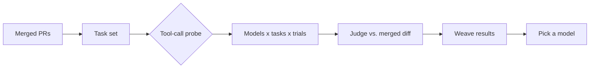

# Coding Agent Eval Kit

Pick an open model for your coding agent based on **your own merged pull requests**, not a public benchmark.

The kit turns recent merged PRs from a repository into replayable tasks. It runs open models and your current
closed model on each task several times through a small instrumented agent harness. A judge model grades every
attempt against the diff that actually merged, and everything is tracked in
[W&B Weave](https://docs.coreweave.com/products/wandb/weave). You get each model's completion rate, tool-call
accuracy, speed, and cost per successful task, broken down by task type.

This is the companion to the CoreWeave blog post *Choosing an Open Model for your Coding Agent*.



## What's here

| Path | Purpose |
|------|---------|
| `notebook.py` | Guided [marimo](https://marimo.io) notebook: connect, build tasks, probe, run, read results |
| `coding_eval/tasks.py` | Mine merged PRs into tasks (quick edits, multi-file features, optional planning tasks) |
| `coding_eval/probe.py` | One-minute check that each model's tool calls survive your serving stack, streaming and non-streaming |
| `coding_eval/agent.py` | Instrumented agent loop with `strict` and `forgiving` harness profiles |
| `coding_eval/workspace.py` | Per-attempt throwaway checkout and the tools the agent can call |
| `coding_eval/grading.py` | Judge plus tool-call and efficiency scorers |
| `coding_eval/evaluate.py` | Weave evaluations, leaderboard, and the "cheapest first, escalate on failure" simulation |

## Prerequisites

- Python 3.12+ and [uv](https://docs.astral.sh/uv/)
- `git`, and read access to the repository you want to evaluate (any URL `git clone` accepts, or a local path)
- A **W&B API key** (`WANDB_API_KEY`) for Weave tracing; it also authenticates CoreWeave
  [Serverless Inference](https://docs.coreweave.com/products/inference/serverless)
- An **Anthropic API key** (`ANTHROPIC_API_KEY`), only if you include a Claude baseline or choose a Claude judge
- Optional: `GITHUB_TOKEN` (or a logged-in `gh` CLI) so task prompts use full PR descriptions and linked issues

## Run it

From this directory (the notebook imports the local `coding_eval` package):

```bash
cd inference/coding-agent-eval
export WANDB_API_KEY=...          # or paste it into the notebook
export ANTHROPIC_API_KEY=...      # only for a Claude baseline or judge
uvx marimo edit --sandbox notebook.py
```

`--sandbox` installs the dependencies declared at the top of `notebook.py` into an isolated environment.

Then work through the notebook top to bottom:

1. **Connect**: keys, your Weave project (`entity/project`), and optionally a Serverless Inference usage project
   (`team/project`). The usage project is needed if your account belongs to more than one team.
2. **Build Your Task Set**: point it at a repository. Start with 5 tasks to check the setup; about 30 separates models.
3. **Choose Models**: three or four open models plus your baseline. Edit prices to match your contract.
4. **Probe Tool Calls**: about a minute, a few cents.
5. **Run the Evaluation**: confirm the attempt and request estimate before starting.
6. **Results** and **Picking a model**: completion vs. cost per success, by task type and harness profile.
7. **Use the Winner**: configuration for Cline, OpenCode, or any OpenAI-compatible tool.

## Cost

You pay for every model and judge request, using your own keys. The notebook shows the number of attempts and an
estimate of model requests before each run. A smoke run (5 tasks x 4 models x 1 trial) is about 20 attempts and
roughly 300 model requests. A full run (30 tasks x 4 models x 3 trials) is about 360 attempts. Check current prices
for the models you pick.

## Safety

Each attempt runs in a temporary clone on **your machine, as your user**. The agent can read and edit files in that
clone. Its `run_command` tool accepts only a small allowlist of read-only programs (`ls`, `cat`, `head`, `grep`,
read-only `git`, ...), with arguments confined to the clone and no pipes or redirects. That is a guardrail, not a
sandbox:

- Use repositories you trust, and that you are allowed to send to the model providers. Prompts, diffs, tool calls
  and tool output go to those providers and to your Weave project.
- To let agents run tests, or to evaluate untrusted code, run the kit in an isolated environment such as a
  [CoreWeave Sandbox](https://docs.coreweave.com/products/sandboxes). `allow_any_command=True` is only for such
  environments.

## Reading the results

- **completion_rate** is the share of all attempts the judge accepted. **unjudged** counts attempts the judge
  couldn't grade; they count as failures, so fix the judge if this is more than a handful.
- **cost_per_success** is total spend divided by passing attempts. Compare models on this number: a cheap model
  that needs three tries isn't cheap.
- The gap between the **strict** and **forgiving** profiles shows how much a harness is covering up: failures your
  developers wouldn't see, but would pay for in retries, latency, and tokens.
- The judge must not be one of the candidates; the notebook refuses to run if it is. Spot-check a sample of verdicts
  against your own reviewers before relying on close results.
