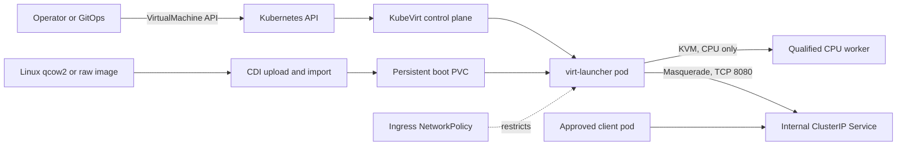

# CPU-only KubeVirt on CKS

> **Reference status:** Customer-managed and self-deployed. This example is not a managed CKS feature, a CKS support commitment, or a deployment validated against a live CKS cluster.

## Use case

Use this pattern to **rehost one existing Linux VM-packaged application during a move to Kubernetes**. It fits an application that still needs its own guest operating system, but can use a normal Kubernetes Service for access and a PVC for its boot disk. Kubernetes then manages the VM resource and its placement alongside container workloads.

This is an offline rehost example: CDI imports a disk image, then KubeVirt boots it. It does not migrate a running VM, recreate a full OpenStack/IaaS environment, or provide high availability. Prefer a container deployment when the guest OS is no longer required.

The example assumes the imported guest is configured to use DHCP and that the application listens on TCP port 8080. Adapt the VM interface, Service, NetworkPolicy, and guest configuration to the actual workload before applying them.

## Scope and support boundary

- **GPU VFIO passthrough is not supported on CKS.** Do not configure GPU passthrough for KubeVirt VMs in this architecture.
- This reference is for **CPU-only Linux VMs** on CPU nodes. CPU-only KubeVirt may work on a qualified cluster, but it remains self-managed and is not a formally supported or managed CKS capability.
- Direct host-device access, including host NVMe passthrough, SR-IOV, and layer-2 networking, is outside this example.
- Windows guests, live migration, failover/HA, public ingress, and multi-tenant VM isolation are outside this first pattern.

## Architecture



### Responsibilities

| Layer | Responsibility |
| --- | --- |
| CKS | Kubernetes API, scheduling, cluster storage, and pod networking. |
| CPU worker | Provides hardware virtualization and accessible `/dev/kvm` for the VM workload. |
| KubeVirt | Adds VM APIs and runs each VM in a `virt-launcher` pod. |
| CDI | Uploads/imports a raw or qcow2 disk image into a PVC. |
| StorageClass/PVC | Persists the guest boot disk. You select and qualify the storage class. |
| Service and NetworkPolicy | Provide internal app access and restrict which client pods can reach the guest. |

## Version and cluster gates

The manifest example uses the `node.coreweave.cloud/class: cpu` node label. Verify that label exists on the target cluster and change it if the cluster uses a different CPU-pool label.

The version pins below are a starting point, **not a claim that this combination has been qualified on CKS**. KubeVirt v1.9.0 documents Kubernetes 1.34–1.36 support. Check the actual cluster minor version, the selected CDI release's compatibility requirements, and CKS admission policy before installing either component. If the cluster minor version is outside the KubeVirt release's support window, select a matching KubeVirt release instead.

| Component | Example pin | Compatibility check |
| --- | --- | --- |
| KubeVirt | `v1.9.0` | Kubernetes 1.34–1.36 per the release notes. |
| CDI | `v1.66.1` | Verify its Kubernetes and KubeVirt requirements for the chosen cluster before installation. |
| `virtctl` | Match the selected KubeVirt release | Use the client from the same KubeVirt release. |

Before installation, have the cluster/platform owner confirm all of the following:

1. The cluster's Kubernetes minor version is supported by the chosen KubeVirt and CDI releases.
2. CKS admission policy permits KubeVirt's privileged `virt-handler` DaemonSet and required host access. Cluster-admin access alone may not satisfy this gate.
3. The intended CPU nodes have hardware virtualization enabled and usable `/dev/kvm`, and the example node label maps only to those nodes.
4. The cluster CNI enforces Kubernetes NetworkPolicy for VM launcher pods. The example policy only protects the guest if the CNI enforces it.
5. The selected StorageClass can provision a persistent PVC with the requested capacity and access/volume mode. Check or configure CDI's StorageProfile for that class.
6. The guest image is trusted, boots with DHCP on the pod network, and has the expected application port and guest credentials configured.

Useful read-only inventory commands:

```sh
kubectl version
kubectl get nodes -L node.coreweave.cloud/class
kubectl get storageclass
```

After CDI is installed, inspect its storage profiles with `kubectl get storageprofile`. The `/dev/kvm` and CKS admission gates require confirmation against the target cluster; these inventory commands do not prove them.

## Install KubeVirt and CDI

Run these only after the version and CKS gates above are cleared. They install cluster-wide operators and require the appropriate cluster-admin privileges. The commands use pinned release manifests; review the upstream release notes and manifests before applying them to a cluster.

```sh
kubectl apply -f https://github.com/kubevirt/kubevirt/releases/download/v1.9.0/kubevirt-operator.yaml
kubectl apply -f https://github.com/kubevirt/kubevirt/releases/download/v1.9.0/kubevirt-cr.yaml
kubectl -n kubevirt wait kv/kubevirt --for=condition=Available --timeout=5m

kubectl apply -f https://github.com/kubevirt/containerized-data-importer/releases/download/v1.66.1/cdi-operator.yaml
kubectl apply -f https://github.com/kubevirt/containerized-data-importer/releases/download/v1.66.1/cdi-cr.yaml
kubectl -n cdi wait cdi/cdi --for=condition=Available --timeout=5m
```

Install the matching `virtctl` client using the [KubeVirt installation guide](https://kubevirt.io/user-guide/cluster_admin/installation/). Do not proceed if either operator fails its `Available` condition.

## Import the guest boot disk

The example PVC is named `linux-rootdisk` and requests 40 GiB. Choose a StorageClass that is valid for the cluster and large enough for the **expanded virtual disk**, not just the compressed qcow2 file. The example uses `ReadWriteOnce` and `Filesystem`; change these to match the StorageClass, CDI StorageProfile, and guest requirements.

Create the workload namespace:

```sh
kubectl apply -f manifests/namespace.yaml
```

In one terminal, open a loopback-only port-forward to CDI's upload proxy:

```sh
kubectl -n cdi port-forward --address 127.0.0.1 service/cdi-uploadproxy 8443:443
```

In another terminal, upload the disk using the `virtctl` version that matches KubeVirt. Replace `YOUR_STORAGE_CLASS` and the image path. `--insecure` is shown only for this TLS endpoint reached through a local loopback port-forward; do not use it for a remote endpoint. For another environment, configure and trust the upload proxy certificate instead.

```sh
virtctl image-upload pvc linux-rootdisk \
  --namespace=vm-workloads \
  --size=40Gi \
  --image-path=./linux-rootdisk.qcow2 \
  --storage-class=YOUR_STORAGE_CLASS \
  --access-mode=ReadWriteOnce \
  --volume-mode=Filesystem \
  --uploadproxy-url=https://127.0.0.1:8443 \
  --insecure
```

Wait for the upload to complete and confirm the PVC is `Bound` before applying the VM resources. Avoid placing credentials or signed image URLs in the repository or command history.

## Deploy the VM and internal service

Review and customize the node selector, CPU/memory requests, guest port, and labels in the manifests. After the imported PVC is `Bound`, apply the ingress policy first so it is in place before the VM launcher pod starts, then apply the VM and Service:

```sh
kubectl apply -f manifests/network-policy.yaml
kubectl apply -f manifests/virtualmachine.yaml
kubectl apply -f manifests/service.yaml
```

The VM requests 2 vCPU and 4 GiB of memory, uses the PVC as its persistent boot disk, selects CPU nodes, and attaches to the default pod network with KubeVirt masquerade. Only TCP port 8080 is declared for forwarding to the guest. The `linux-legacy-vm` Service is internal (`ClusterIP`).

The NetworkPolicy allows ingress to TCP 8080 only from same-namespace pods labeled `app.kubernetes.io/component: vm-client`. Apply that label only to approved client pods, or edit the policy to match your intended client namespace and workload. The policy does not restrict egress. Verify policy behavior with the cluster CNI before relying on it for isolation or exposing the Service to additional networks.

Check rollout and storage state:

```sh
kubectl -n vm-workloads get vm,vmi,pvc,service,networkpolicy
kubectl -n vm-workloads describe vm linux-legacy-vm
```

The guest itself must be configured to serve the application on TCP 8080. Guest OS login, SSH/RDP access, application health checks, secrets, and public exposure are intentionally not configured by these manifests.

## Operations and limitations

- `runStrategy: Always` asks KubeVirt to restart the VM when it stops; it does not provide HA or a recovery guarantee.
- Back up and restore the PVC and guest data using a separately qualified process. PVC persistence is not a backup.
- Plan guest OS patching, KubeVirt/CDI upgrades, image refreshes, monitoring, and incident response as customer-owned operations.
- This pattern does not configure live migration. Do not infer live migration or failover support from the VM being scheduled on Kubernetes.
- For stateful applications, decide explicitly where application data lives and how it is backed up before moving production traffic.

## Upstream references

- [KubeVirt v1.9.0 release](https://github.com/kubevirt/kubevirt/releases/tag/v1.9.0)
- [KubeVirt release notes and Kubernetes compatibility](https://kubevirt.io/user-guide/release_notes/)
- [CDI v1.66.1 release](https://github.com/kubevirt/containerized-data-importer/releases/tag/v1.66.1)
- [KubeVirt installation](https://kubevirt.io/user-guide/cluster_admin/installation/)
- [CDI storage and image import](https://kubevirt.io/user-guide/storage/containerized_data_importer/)
- [VM network interfaces](https://kubevirt.io/user-guide/network/interfaces_and_networks/)
- [Using Kubernetes Services with VMs](https://kubevirt.io/user-guide/network/service_objects/)
- [Kubernetes NetworkPolicy with KubeVirt](https://kubevirt.io/user-guide/network/networkpolicy/)
- [VM resource requests and limits](https://kubevirt.io/user-guide/compute/resources_requests_and_limits/)
